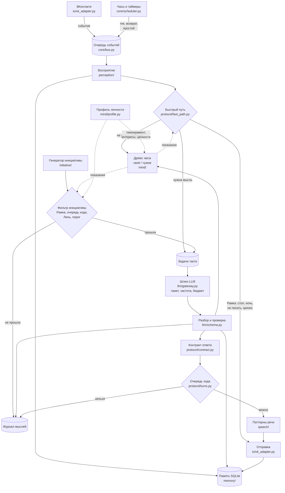
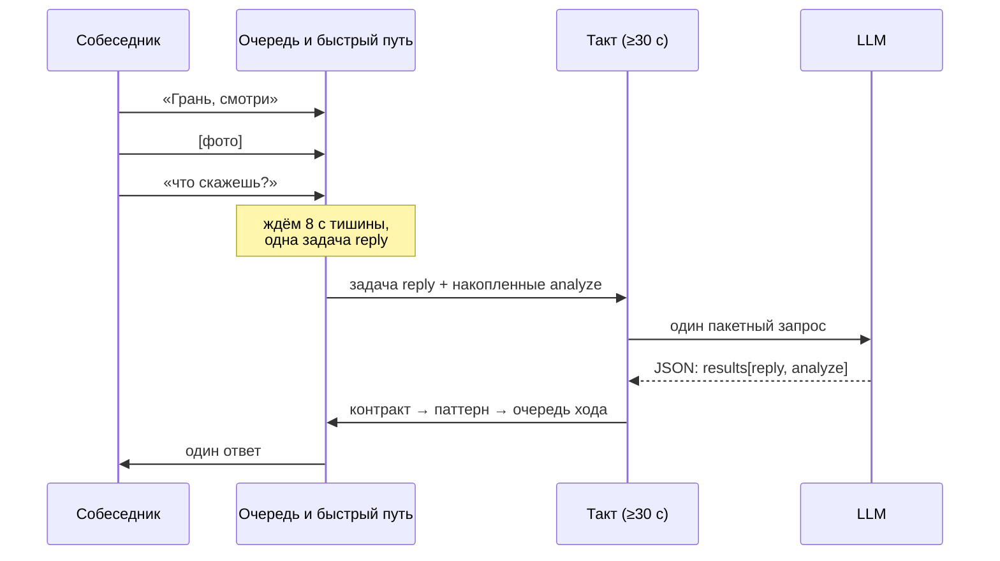
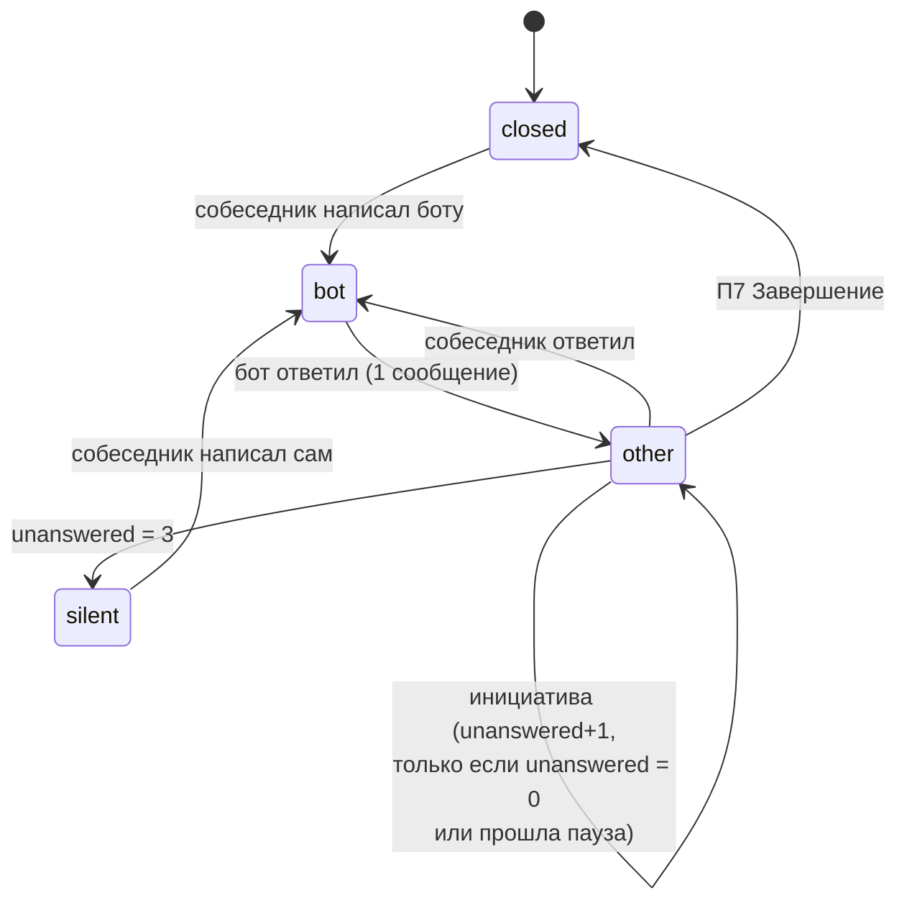
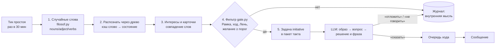

# Отчёт от 2026-10-14: архитектура кода ядра коммуникации и приоритетов мышления

> Контекст: [задача #11](https://github.com/PavelChurkin/ai_mind_test1/issues/11), продолжение [отчёта от 2026-10-04](Отчёт%202026-10-04%20—%20чего%20не%20хватает%20в%20древе.md).
> Источники: [Ядро коммуникации](Ядро%20коммуникации.md), [Приоритеты мышления](Приоритеты%20мышления.md),
> [Паттерны речи](Паттерны%20речи.md), древо [`mind1.json`](../mind1.json), бот [`ai_mind3.py`](../ai_mind3.py),
> чат-бот [`Прочее/bot4.py`](../Прочее/bot4.py), проект [ai_filosof](https://github.com/PavelChurkin/ai_filosof).
> Это проект архитектуры, а не готовый код. Имена файлов, поля и числа ниже — предложения для обсуждения.
> Все числа — настройки по умолчанию, их можно менять.

## Содержание

1. [Краткий вывод](#1-краткий-вывод)
2. [От чего отталкиваемся — факты](#2-от-чего-отталкиваемся--факты)
3. [Общая схема: один процесс, много модулей](#3-общая-схема-один-процесс-много-модулей)
4. [Модули по файлам](#4-модули-по-файлам)
5. [Такт мышления: когда бот думает и когда обращается к LLM](#5-такт-мышления-когда-бот-думает-и-когда-обращается-к-llm)
6. [Проблема 1. Бот не ждёт ответа собеседника](#6-проблема-1-бот-не-ждёт-ответа-собеседника)
7. [Проблема 2. Состояние «Лень»](#7-проблема-2-состояние-лень)
8. [Проблема 3. Стоимость обращений к LLM](#8-проблема-3-стоимость-обращений-к-llm)
9. [Протокол как промпт-цепочка](#9-протокол-как-промпт-цепочка)
10. [«Своё» и «чужое»: два набора весов](#10-своё-и-чужое-два-набора-весов)
11. [Профиль личности: темперамент, интересы, ценности, паттерны речи](#11-профиль-личности-темперамент-интересы-ценности-паттерны-речи)
12. [Интересы и ценности: как они работают](#12-интересы-и-ценности-как-они-работают)
13. [Карточка собеседника: формат и хранение](#13-карточка-собеседника-формат-и-хранение)
14. [Память о мире: факт / интерпретация / домысел](#14-память-о-мире-факт--интерпретация--домысел)
15. [Генератор инициативы: ai_filosof + древо + протокол](#15-генератор-инициативы-ai_filosof--древо--протокол)
16. [Инициатива без навязчивости: порог и Рамка](#16-инициатива-без-навязчивости-порог-и-рамка)
17. [«О чём ты думаешь?» — журнал мыслей](#17-о-чём-ты-думаешь--журнал-мыслей)
18. [Порядок реализации](#18-порядок-реализации)
19. [Открытые вопросы](#19-открытые-вопросы)

---

## 1. Краткий вывод

**Да, одним файлом не обойтись, но и много программ не нужно.** Достаточно **одного процесса** (одна точка входа, `asyncio`) и примерно двадцати модулей. Они делятся на пять слоёв:

| Слой | Что делает | Обращается к LLM? |
|---|---|---|
| **Ввод-вывод** | ВКонтакте (на базе `bot4.py`), консоль для тестов | Нет |
| **Восприятие и память** | Нормализует события; хранит сообщения, карточки людей, факты о мире, журнал мыслей | Нет |
| **Древо и личность** | Веса «своё» / «чужое», затухание, Лень, профиль личности | Нет |
| **Протокол** | 7 приоритетов, контракт ответа, порог ответа, генератор инициативы | Только через шлюз |
| **Шлюз LLM** | Единственная точка вызова модели: пакеты, частота, бюджет, разбор ответа | Да |

Три проблемы из задачи решаются так.

1. **Бот закидывает сообщениями.** Это решает **очередь хода** ([раздел 6](#6-проблема-1-бот-не-ждёт-ответа-собеседника)). Один входящий ход даёт не больше одного ответа. Инициатива возможна, только когда последнее слово за собеседником. После безответного сообщения пауза растёт: сутки, двое, четверо. После трёх безответных бот молчит, пока собеседник не напишет сам.
2. **Лень.** Это новое **накапливающееся** состояние «своего» набора весов ([раздел 7](#7-проблема-2-состояние-лень)):
   - каждое действие её повышает, покой её снижает;
   - действие происходит, только если желание минус Лень выше порога;
   - если от контакта ничего не нужно, желание равно нулю, и контакт не начинается при любой Лени.
3. **Стоимость LLM.** Предположение автора верно ([раздел 8](#8-проблема-3-стоимость-обращений-к-llm)):
   - мыслительные процессы, накопленные за такт, отправляются **одним пакетным запросом** с ответом в JSON;
   - такт идёт **не чаще раза в 30 секунд** (настраивается) и только когда есть работа;
   - всё, что можно решить правилами (Рамка, очередь хода, Лень, затухание, случайные слова), решается **без LLM**;
   - когда дневной бюджет исчерпан, бот переходит в режим «отвечать только на обращения».

В `ai_mind3.py` на каждое сообщение приходится три вызова LLM. В предложенной схеме вызовов не больше двух в минуту при любой нагрузке, а в тихом чате вызовов нет вовсе.

Симуляция [`experiments/simulate_initiative_gate.py`](../experiments/simulate_initiative_gate.py) показывает, как это работает для собеседника, который не отвечает. За трое суток:

- **наивное правило** «вес мысли выше порога — пишем» отправляет **40** сообщений, из них 17 ночью;
- **предложенный фильтр** (Рамка + очередь хода + Лень) отправляет **2**.

---

## 2. От чего отталкиваемся — факты

**`ai_mind3.py`**: прототип мышления, консольный.

- На каждое сообщение он делает три запроса к LLM:
  1. `analyze_user_states` — состояния собеседника;
  2. `generate_response` — ответ;
  3. `delayed_analysis` — через 5 секунд повторный анализ весов.

  Если после этого какой-то вес достиг `spontaneous_threshold = 1.0`, добавляется четвёртый запрос, `generate_spontaneous_response`.
- Спонтанное сообщение отправляется **без проверки, ответил ли собеседник**. Понятия «чей ход» нет.
- Затухания по времени нет. Вес уменьшается только при срабатывании (на 0.4), а каждое новое сообщение снова добавляет +0.2 к состоянию и +0.1 к его родителям. Поэтому активные ветви быстро возвращаются к порогу.

  Это и есть причина «закидывания» сообщениями, о которой пишет автор.
- Веса одни, и это веса **собеседника**: бот отражает чужие состояния (см. [отчёт 2026-10-04, раздел 4](Отчёт%202026-10-04%20—%20чего%20не%20хватает%20в%20древе.md#4-что-есть-в-древе-сейчас--факты)).

**`Прочее/bot4.py`**: работающий чат-бот сообщества ВК, сделан в этой же задаче. Из него можно взять готовый слой ввода-вывода и памяти чата:

- Long Poll;
- хранение сообщений с уникальностью по `(peer_id, conversation_message_id)`;
- имена людей и сообществ;
- текст пересланных сообщений и постов;
- картинки для vision-модели;
- reply в беседах;
- ограничение частоты вызовов LLM;
- тесты с подменой ВК и LLM.

Мышления в нём нет: он отвечает, когда к нему обратились, на основе последних 40 сообщений.

**`mind1.json`**: 79 состояний, у узла три поля — `название`, `условия`, `вес`. Состояний «Лень», «Усталость», «Скука» нет.

**ai_filosof**: конвейер «случайные слова (`nouns.json`, `adject.json`, `verbs.json`) → образ и роль → вопрос → ответ».

---

## 3. Общая схема: один процесс, много модулей



Ключевые решения:

1. **Один процесс, один цикл событий.** Всё приходит в одну очередь: сообщения ВК, тики часов, таймеры возврата, сигнал простоя. Так проще избежать гонок. Именно гонка между двумя задачами (ответ и `delayed_analysis`) и даёт лишние сообщения в `ai_mind3.py`. Если позже понадобится, медленное мышление можно вынести во второй процесс, оставив общую базу SQLite.
2. **LLM вызывает только шлюз.** Модули не зовут модель сами, а **ставят задачу** в очередь такта. Шлюз раз в такт собирает задачи в один запрос.
3. **Быстрый путь без LLM.** Рамку (стоп-слова, «не пиши», ночь, явный кризис), очередь хода, Лень, затухание и выбор случайных слов можно посчитать правилами. Это то же разделение, что в [отчёте 2026-10-04, 7.1](Отчёт%202026-10-04%20—%20чего%20не%20хватает%20в%20древе.md#71-туннелировать-мышление-не-зацикливаясь-на-ощущениях): быстрый путь — кэш, медленный — запрос к модели.
4. **Отправка проходит через очередь хода.** Последняя проверка перед ВК: не говорит ли бот лишний раз.
5. **Всё, что бот подумал и не сказал, записывается в журнал мыслей.** Из журнала потом отвечается вопрос «о чём ты думаешь» ([раздел 17](#17-о-чём-ты-думаешь--журнал-мыслей)).

---

## 4. Модули по файлам

```
gran/
├── main.py                  # точка входа: загрузка настроек, запуск цикла событий
├── config.py                # все настраиваемые периоды, пороги, бюджеты (раздел 8.6)
├── core/
│   ├── bus.py               # очередь событий: Event(kind, peer_id, user_id, payload, ts)
│   ├── scheduler.py         # такт мышления, таймеры возврата, сигнал простоя
│   └── clock.py             # «сейчас», часовой пояс, ночь/день (подменяется в тестах)
├── io/
│   ├── vk_adapter.py        # из bot4.py: Long Poll, vk_send, reply, вложения, имена
│   └── console_adapter.py   # тот же интерфейс для отладки и тестовых диалогов
├── perception/
│   ├── normalize.py         # событие → Percept: кто, кому, текст, картинки, reply, пересланное
│   └── detectors.py         # правила: обращение к боту, «не пиши», «стоп», кризисные слова, «о чём думаешь»
├── memory/
│   ├── store.py             # SQLite: схема, миграции (таблицы messages из bot4 + новые)
│   ├── people.py            # карточки собеседников (раздел 13)
│   ├── world.py             # факты о мире с пометками (раздел 14)
│   ├── journal.py           # журнал мыслей (раздел 17)
│   └── dialogs.py           # состояние диалога: чей ход, безответные, паузы (раздел 6)
├── mind/
│   ├── tree.py              # загрузка mind2.json, распространение веса к родителям, затухание
│   ├── weights.py           # два набора: self и other[(peer_id, user_id)] (раздел 10)
│   ├── laziness.py          # Лень: накопление, восстановление, проверка «желание − Лень» (раздел 7)
│   └── profile.py           # профиль личности: темперамент, интересы, ценности (раздел 11)
├── protocol/
│   ├── fast_path.py         # быстрый путь: П1 Рамка правилами, порог ответа без LLM
│   ├── pipeline.py          # 7 приоритетов: какие шаги нужны и что отдать в LLM (раздел 9)
│   ├── contract.py          # контракт ответа (dataclass) и проверка его заполнения
│   ├── threshold.py         # порог ответа: ответить / уточнить / отложить / промолчать
│   ├── turns.py             # очередь хода (раздел 6)
│   └── prompts/             # шаблоны: system.md, batch.md, по одному блоку на тип задачи
├── initiative/
│   ├── filosof.py           # случайные слова и образ (из ai_filosof; без LLM)
│   └── gate.py              # фильтр инициативы: интересы, карточки, Рамка, ход, Лень, порог
├── speech/
│   └── patterns.py          # кирпичики и структуры из «Паттернов речи», выбор по действию
├── llm/
│   ├── gateway.py           # пакетирование, частота, бюджет, повторы, кэш
│   ├── schema.py            # JSON-схема пакетного ответа, разбор, проверка, «ремонт»
│   └── usage.py             # учёт токенов и запросов за сутки
├── data/
│   ├── mind2.json           # древо с новыми узлами и свойствами (Лень и др.)
│   └── profile.json         # профиль личности
└── tests/
    ├── dialogs/             # тестовые диалоги из «Приоритетов» и «Паттернов» (раздел 18)
    └── test_*.py            # модульные тесты с подменой LLM и ВК (как experiments/test_bot4.py)
```

| Модуль | Вход | Выход | Состояние |
|---|---|---|---|
| `io/vk_adapter` | Long Poll | `Event` в очередь; отправка по команде | нет (кроме сессии ВК) |
| `perception` | `Event` | `Percept` + сохранение сообщения | нет |
| `protocol/fast_path` | `Percept`, карточка, состояние диалога | решение: молчать / ответить шаблоном / поставить задачу LLM | нет |
| `mind/*` | результаты разбора, время | веса, Лень | `self`, `other`, Лень (в БД) |
| `initiative/*` | тик простоя, профиль, карточки | кандидат мысли → задача LLM или журнал | счётчики попыток |
| `llm/gateway` | задачи такта | один запрос → результаты по `id` | очередь задач, расход за сутки |
| `protocol/contract` + `speech` | результат LLM | текст реплики | нет |
| `protocol/turns` | реплика, состояние диалога | отправить / отложить / в журнал | `dialogs` (в БД) |

Правило зависимостей: `io` ничего не знает о мышлении, а `mind` ничего не знает о ВК. Тогда тот же «мозг» можно подключить к Telegram или консоли.

---

## 5. Такт мышления: когда бот думает и когда обращается к LLM

Бот работает **тактами**. Между тактами события обрабатываются локально: сохраняются, обновляют счётчики, проходят быстрый путь. Если для события нужна мысль модели, оно превращается в **задачу** в очереди такта.

| Тип задачи | Откуда | Срочность | Пример |
|---|---|---|---|
| `reply` | обращение к боту (имя, reply, личка) | высокая — человек ждёт | «Грань, что думаешь?» |
| `safety` | детектор кризисных слов | высшая — вне очереди | «не хочу жить» |
| `analyze` | накопленные сообщения беседы, не адресованные боту | низкая | 15 сообщений спора о кино |
| `initiative` | генератор инициативы прошёл фильтр | низкая | мысль «ждать результатов» + карточка Ани |
| `facts` | новые утверждения о мире или о людях | низкая | «я переехал в Казань» |
| `card` | завершение разговора (П7) | низкая | обновить карточку: тема, вопрос, возврат |
| `reflect` | долгий простой (по профилю) | самая низкая | «о чём я думал сегодня» → журнал |

Правила такта (`core/scheduler.py`):

1. **Пустой такт не делает запроса.** Если задач нет, LLM не вызывается.
2. **Минимальный интервал между запросами: `LLM_MIN_INTERVAL_SEC = 30`.** Отдельно можно задать более короткий `REPLY_MIN_INTERVAL_SEC` (например, 5) для такта, в котором есть `reply`, чтобы человек не ждал полминуты. Если нужна жёсткая экономия, оба равны 30. Тогда худшая задержка ответа — 30 секунд, и это похоже на человеческую паузу.
3. **Такт с `reply` забирает и фоновые задачи.** Раз запрос всё равно идёт, в него добавляются `analyze`, `card` и другие фоновые задачи, пока хватает лимита токенов (раздел 8.3).
4. **`safety` не ждёт такта.** Первый ответ при кризисе — шаблон без LLM: «Мне важно, что ты написал. Если тебе сейчас плохо, позвони…». Модель подключается на следующем такте.
5. **Ожидание конца реплики.** Люди часто пишут мыслью из трёх сообщений подряд. Задача `reply` ставится только через `DEBOUNCE_SEC = 8` после последнего сообщения этого человека. Новое сообщение в это время перезапускает ожидание, и ответ будет один на все три.



---

## 6. Проблема 1. Бот не ждёт ответа собеседника

### 6.1. Почему это происходит

В `ai_mind3.py` у бота нет понятия хода. После каждого ответа запускается `delayed_analysis`. Если вес достиг 1.0, она сразу генерирует ещё одну реплику (раздел 2). Добавление инициативы из случайных мыслей, если его сделать так же «по порогу веса», усилит проблему. Симуляция в разделе 1 показывает, что такое правило пишет молчащему человеку десятки сообщений за трое суток, в том числе ночью.

### 6.2. Состояние диалога

Для каждой пары «беседа — собеседник» (в личке это одно и то же) храним состояние диалога (`memory/dialogs.py`):

| Поле | Смысл |
|---|---|
| `last_in_ts` | Когда собеседник писал последний раз |
| `last_out_ts` | Когда бот писал последний раз |
| `turn` | Чей ход: `other` (ждём собеседника) / `bot` (собеседник ждёт бота) / `closed` (тема закрыта, П7) |
| `unanswered` | Сколько сообщений бота подряд без ответа |
| `next_initiative_ts` | Раньше этого времени инициатива запрещена |
| `do_not_write_until` | Явная просьба «не пиши» (раздел 16) |

### 6.3. Правила очереди хода (`protocol/turns.py`)

1. **Один входящий ход — не больше одного ответа.** Ответ переводит `turn` в `other`. Все остальные мысли этого хода (повторный анализ, спонтанное «и ещё…») идут в журнал или в следующий ответ, но не отдельным сообщением.
2. **Инициатива только при `turn ∈ {closed, other}` и `unanswered = 0`.** Последнее слово должно быть за собеседником, или тема должна быть закрыта.
3. **Пауза после безответного сообщения растёт:** `next_initiative_ts = last_out_ts + 24 ч · 2^(unanswered−1)`, то есть сутки, двое, четверо.
4. **После `MAX_UNANSWERED = 3` безответных бот сам не пишет**, пока собеседник не напишет первым. В карточку ставится пометка «молчит». Ответ собеседника обнуляет `unanswered`.
5. **Исключение — договорённость.** Если человек сам попросил напомнить («напиши завтра, как там»), это возврат с явным согласием, и пауза не действует. Но он тоже считается безответным, если ответа не было.
6. **В беседе.** Если люди сейчас активно переписываются между собой, бот не встревает с инициативой: за `CHAT_BUSY_WINDOW = 10 мин` было больше `N` сообщений не к боту. Кроме того, лимит инициатив на беседу — не больше `CHAT_INITIATIVE_PER_DAY = 2` в сутки.



Очередь хода — правило, а не чувство. Чувство, которое делает поведение естественным, — Лень: ниже она отвечает за то, чтобы самому **не хотелось** писать в пустоту.

---

## 7. Проблема 2. Состояние «Лень»

### 7.1. Что это и чем отличается от соседних состояний

Автор определяет Лень так: **«активное нежелание что-либо делать, в том числе продолжать что-либо делать»**, причём **накапливающееся**. Чтобы бот не путал её с похожими состояниями, их стоит развести:

| Состояние | Суть | Как снимается | Что делает бот |
|---|---|---|---|
| **Лень** | Цена действия кажется выше желания; растёт от действий без отдачи | Покой, отдача (ответ, благодарность), сильный интерес | Не начинает, сворачивает, отвечает короче |
| **Усталость** *(из 5.2 прошлого отчёта)* | Ресурс исчерпан объёмом работы | Только отдых (время) | Честно берёт паузу |
| **Скука** | Нет интересного стимула | Новый стимул | Наоборот, **толкает** искать тему (повышает инициативу) |
| **Пустота** *(есть в древе)* | Покой, нет активных состояний | — | Ничего |
| **Безнадёжность** *(есть, под «Сомнением»)* | Не верит, что действие поможет | Факты, успех | Отказывается от цели |

Рядом с Ленью в древе уже есть «Потом» (под «О грёзах») и «Зачем вообще» (под «О былом»). Это **мысли**, которые Лень порождает. Лень — **состояние**, к которому они ведут.

### 7.2. Узел в древе

Предлагаемый узел для `mind2.json` с новыми свойствами из [отчёта 2026-10-04, 5.3](Отчёт%202026-10-04%20—%20чего%20не%20хватает%20в%20древе.md#53-новые-свойства-узлов) (старые поля сохранены для совместимости):

```json
{
  "название": "Лень",
  "условия": ["Пустота"],
  "вес": 0.0,
  "базовый_уровень": 0.2,
  "затухание_мин": 120,
  "валентность": -0.2,
  "возбуждение": 0.1,
  "чьё": "своё",
  "приоритет": 2,
  "разрешённые_действия": ["Пауза", "Завершение", "Отказ", "Уточнить"],
  "выход": ["Потом", "Зачем вообще", "Смирение"],
  "накапливается": true
}
```

`приоритет: 2` означает, что Лень проверяется на шаге **Цель**: «хочу ли я вообще что-то от этого контакта и стоит ли оно усилий».

### 7.3. Как Лень накапливается и спадает (`mind/laziness.py`)

Лень хранится на двух уровнях:

- **общая** `L` — в своём наборе весов: «вообще ничего не хочется»;
- **к собеседнику** `L[c]` — в карточке: «не хочется писать именно ему». Растёт от безответных сообщений и спадает, когда он отвечает.

| Событие | Изменение |
|---|---|
| Своё сообщение-ответ | `L ← L + 0.05·(1 − L)` |
| Длинный ответ, пересказ, анализ картинки | `L ← L + 0.10·(1 − L)` |
| Своя инициатива | `L ← L + 0.15·(1 − L)` |
| Инициатива осталась без ответа | `L[c] ← L[c] + 0.20·(1 − L[c])` |
| Та же тема по кругу (узел «Снова или опять» активен) | `L ← L + 0.10·(1 − L)` |
| Собеседник ответил, поблагодарил | `L[c] ← max(0, L[c] − 0.3)` |
| Время (каждый тик) | `L ← L₀ + (L − L₀)·e^(−Δt/τ)`, τ = 2 ч, L₀ — базовый уровень из темперамента |

Формула `x + c·(1 − x)` даёт накопление с насыщением: Лень растёт быстро, пока её мало, и никогда не превышает 1.

### 7.4. Как Лень влияет на решения

Главная проверка перед любым действием по своей воле:

```
желание − max(L, L[c]) ≥ порог_действия
```

где **желание** берётся на шаге П2 Цель:

```
желание = max(сила цели контакта, интерес темы, долг)
```

- **сила цели контакта** — 0, если бот ничего не хочет от контакта;
- **интерес темы** — из профиля (раздел 12);
- **долг** — обещанный возврат, вопрос из карточки.

| Действие | Порог | Что значит |
|---|---|---|
| Ответить на прямое обращение | **нет проверки** | Лень **не отменяет** ответ на вопрос. Она делает его короче или превращает в честную паузу: «Давай завтра, сейчас не соображаю» |
| Продолжить тему (задать встречный вопрос) | 0.3 | Уставший бот отвечает, но не развивает |
| Начать контакт самому | 0.5 при L₀ = 0.2, то есть желание ≥ 0.7 в покое | Нужна сильная причина |
| Длинная работа (пересказ 500 сообщений) | 0.2 | Можно отказаться: «длинно, перескажу главное» |

**«Ничего не хочу от контакта — не начинать контакт».** Это нулевое правило, и оно отдельно от Лени. Если на шаге П2 у бота нет цели для этого человека (цель «Нет»), желание равно 0, и проверка не проходит **при любой Лени**. Это прямо соответствует вопросу 1 ядра: без «чего я хочу» инициатива не начинается. Мысль при этом не пропадает, а записывается в журнал (раздел 17).

### 7.5. Как Лень видна в речи

Лень выбирает паттерны из [Паттернов речи](Паттерны%20речи.md): «Пауза» (3.7), «Завершение» (3.8), «Пауза → метка → один шаг → завершение» (5.7). Честная формулировка в духе [отчёта 2026-10-04, раздел 8](Отчёт%202026-10-04%20—%20чего%20не%20хватает%20в%20древе.md#8-риски-и-этические-ограничения): «у меня сейчас что-то вроде лени — давай вернёмся к этому вечером?», а не имитация человеческой усталости.

---

## 8. Проблема 3. Стоимость обращений к LLM

### 8.1. Откуда берутся запросы

| Источник | `ai_mind3.py` | Предлагаемая схема |
|---|---|---|
| Сообщение, адресованное боту | 3 запроса (анализ, ответ, повторный анализ) | 0 отдельных: задача `reply` в ближайшем такте |
| Сообщение в беседе не боту | — | 0 отдельных: копятся, одна задача `analyze` на такт |
| Спонтанная реплика | +1 запрос | 0 отдельных: задача `initiative`, если прошла фильтр без LLM |
| Повторный анализ весов | +1 запрос через 5 с | Входит в ответ на `reply` (поля `self_states`, `other_states`) |
| Тихий чат | — | **0 запросов** |
| Худший случай | не ограничен | **≤ 2 в минуту** (≤ 120 в час) при `LLM_MIN_INTERVAL_SEC = 30` |

### 8.2. Пакетный запрос

Автор предполагает «в один запрос отправлять несколько мыслительных процессов одновременно и производить парсинг ответа». Это рабочий подход, если соблюдать три условия:

1. **У каждой задачи свой `id`.** В ответе модель повторяет его, и результаты сопоставляются по `id`, а не по порядку.
2. **Ответ — строгий JSON** с известной схемой для каждого типа задачи. Если API поддерживает `response_format={"type": "json_object"}`, его стоит включить. Если не поддерживает, просить JSON в промпте и чистить обрамление ```` ```json ```` при разборе.
3. **Задачи независимы.** Модель не должна смешивать собеседников. В пакете у каждой задачи свой контекст и своя карточка, а системный промпт прямо говорит: «задачи не связаны, не переносите сведения между ними».

Пример запроса (содержимое `user`, сокращено):

```json
{
  "now": "2026-10-14T21:40+03:00",
  "self": {
    "top_states": [["Любопытство", 0.6], ["Лень", 0.35]],
    "interests": ["время и причины", "как люди принимают решения"],
    "values": ["честность", "не навредить", "свобода собеседника"]
  },
  "tasks": [
    {
      "id": "r1", "type": "reply",
      "peer": "беседа «Кино»", "from": "Аня",
      "card": {"роль": "участница беседы", "одна_тема": "экзамен", "последняя_метка": "Тревога"},
      "context": "[21:30] Дима: …\n[21:38] Аня: Грань, а ты что думаешь?",
      "steps": ["рамка", "цель", "факты", "смысл", "действие"]
    },
    {
      "id": "a1", "type": "analyze",
      "peer": "беседа «Кино»",
      "messages": "[21:31] Дима: …\n[21:33] Петя: …"
    },
    {
      "id": "i1", "type": "initiative",
      "thought": "старый дом ждёт гостей",
      "target": "Аня",
      "card": {"один_вопрос": "пришли ли результаты экзамена"}
    }
  ]
}
```

Пример ответа:

```json
{
  "results": [
    {
      "id": "r1",
      "contract": {
        "рамка": "беседа, свой круг, вечер, угроз нет",
        "цель_бота": "Контакт",
        "цель_собеседника": "Информация",
        "факт": "спрашивает мнение о фильме",
        "пробел": "о каком именно фильме",
        "метка_собеседника": ["Любопытство"],
        "метка_бота": ["Уточнение"],
        "действие": "Уточнить",
        "возврат": null
      },
      "say": "Про тот, что Дима скинул, или про вчерашний?",
      "other_states": {"Аня": {"Любопытство": 0.3}},
      "self_states": {"Уточнение": 0.2}
    },
    {"id": "a1", "other_states": {"Дима": {"Гнев": 0.2}, "Петя": {"Смех или скорбь": 0.3}}, "facts": []},
    {"id": "i1", "decision": "отложить", "reason": "Аня сейчас в разговоре, спрошу завтра", "say": null}
  ]
}
```

### 8.3. Разбор и проверка (`llm/schema.py`)

1. **Достать JSON.** Убрать ```` ``` ````-обрамление, взять подстроку от первой `{` до последней `}`, выполнить `json.loads`. Если не вышло, один «ремонтный» повтор: тот же пакет с пометкой «верни только JSON».
2. **Проверить каждую задачу по схеме её типа.** Названия состояний — только из древа (неизвестные отбрасываются и пишутся в лог), веса обрезаются до [−1, 1], `say` — не длиннее лимита. Пометка факта — одна из трёх (раздел 14).
3. **Частичный успех — норма.** Если для `r1` всё в порядке, а `a1` не разобрался, ответ отправляется, а `a1` возвращается в очередь. У задачи `attempts ≤ 2`, после этого её отбрасываем.
4. **Если пакет не удался совсем**, для `reply` есть запасной путь: отдельный простой запрос, как в `bot4.py`, без контракта. Человек не должен остаться без ответа из-за того, что сломался анализ беседы.
5. **Ограничение размера пакета.** Задачи добавляются по срочности (`safety` > `reply` > `card` > `analyze` > `facts` > `initiative` > `reflect`), пока оценка длины не превысит `BATCH_MAX_INPUT_CHARS`. Остальные ждут следующего такта.

**Цена пакетирования — риск «смешения»:** модель может перенести сведения из одной задачи в другую или ответить хуже на каждую по отдельности. Это стоит проверить экспериментом на тестовых диалогах (раздел 18): пакет из 1, 3 и 6 задач, сравнить качество `reply`. Если качество падает, `reply` идёт отдельным запросом, а пакетируется только фон.

### 8.4. Что делается без LLM

| Работа | Как |
|---|---|
| Рамка: стоп, «не пиши», ночь, лимиты | Правила и регулярные выражения (`perception/detectors.py`) |
| Порог ответа для «ок», «спасибо», стикеров | Правила: промолчать или реакция |
| Очередь хода, Лень, затухание весов | Формулы (разделы 6, 7) |
| Случайные слова для инициативы | Словари ai_filosof (`nouns.json` и др.), без LLM |
| Предварительное «зацепление» мысли за интересы и карточки | Совпадение слов и лемм с ключевыми словами интересов и тем карточек |
| Частые состояния собеседника | Кэш «слово/эмодзи → состояние», который наполняется из прошлых ответов модели («спасибо» → Благодарность) |
| Ответ на «о чём ты думаешь» | Из журнала мыслей; модель нужна только чтобы сформулировать |

### 8.5. Другие способы сократить расход

1. **Короткий контекст.** Последние 40 сообщений, как в `bot4.py`, плюс **сжатый пересказ** более старой истории беседы. Пересказ хранится в БД и обновляется задачей `analyze` не чаще раза в N часов.
2. **Две модели.** Для фона (`analyze`, `facts`, `card`, `reflect`) — дешёвая текстовая модель. Для `reply` с картинками — vision-модель (сейчас `deepseek/deepseek-v4-flash-vision-exp`).
3. **Кэш по хэшу.** Пересказ одного и того же поста или подпись к картинке не запрашиваются повторно.
4. **Учёт по `usage`.** Ответ OpenAI-совместимого API содержит число токенов. `llm/usage.py` суммирует его за сутки.

### 8.6. Настройки шлюза (`config.py`)

| Параметр | По умолчанию | Смысл |
|---|---|---|
| `LLM_MIN_INTERVAL_SEC` | 30 | Не чаще одного запроса за столько секунд (из задачи) |
| `REPLY_MIN_INTERVAL_SEC` | 30 (можно 5) | Интервал для такта с ответом человеку |
| `DEBOUNCE_SEC` | 8 | Ждать конца реплики из нескольких сообщений |
| `BATCH_MAX_TASKS` | 6 | Задач в одном пакете |
| `BATCH_MAX_INPUT_CHARS` | 16000 | Длина пакета |
| `DAILY_REQUEST_LIMIT` | 500 | Запросов в сутки |
| `DAILY_TOKEN_LIMIT` | настраивается | Токенов в сутки |
| `BUDGET_SAFE_MODE_AT` | 0.8 | С 80 % бюджета фон выключается, остаются `reply` и `safety` |
| `IDLE_REFLECT_MIN` | 60 | Задача `reflect` не чаще раза в час простоя |
| `INITIATIVE_TICK_MIN` | 30 | Новая случайная мысль раз в 30 минут |

---

## 9. Протокол как промпт-цепочка

Пункт дорожной карты из прошлого отчёта: «каждому приоритету соответствует короткий вопрос к языковой модели; быстрый путь пропускает очевидные шаги». Но цепочка из семи отдельных запросов противоречит экономии из раздела 8. Решение — **логическая цепочка в одном запросе**:

- каждому приоритету соответствует блок промпта и поле в JSON-ответе;
- модель заполняет поля по порядку, как в контракте ответа ([Ядро коммуникации, 9.1](Ядро%20коммуникации.md#91-поля-контракта));
- шаги, которые уже решены правилами, передаются как готовые значения, и модель их не пересчитывает.

| Приоритет | Кто решает | Вопрос модели (если нужен) | Поле JSON |
|---|---|---|---|
| П1 Рамка | **Правила** (`fast_path`): время, «не пиши», стоп, кризис, роль из карточки | «Есть ли в сообщении признаки опасности или просьбы отстраниться, которых нет в правилах?» | `рамка` |
| П2 Цель | Правила для очевидных случаев (приветствие → Контакт); иначе модель | «Чего хочет собеседник? Чего хочу я, учитывая карточку и мои ценности? Если ничего — "Нет"» | `цель_бота`, `цель_собеседника` |
| П3 Факты | Модель | «Что сказано прямо? Чего не хватает? Что я домысливаю?» | `факт`, `пробел`, `facts[]` |
| П4 Смысл | Показания древа (веса) + модель | «Какие состояния у него и у меня? Что это значит для цели?» | `метка_собеседника`, `метка_бота` |
| П5 Действие | Правила `threshold.py` по контракту + модель | «Одно действие из 16 кирпичиков» | `действие`, `say` |
| П6 Время | Модель предлагает, правила (`turns`) утверждают | «Когда вернуться, если не ответит?» | `возврат` |
| П7 Завершение | Модель | «Тема закрыта? Что записать в карточку?» | `card_update` |

**Быстрый и медленный путь.**

- **Быстрый путь**: правило или кэш дали ответ без LLM («спасибо» → промолчать или реакция; «стоп машина» → выключиться; «не пиши мне» → подтвердить шаблоном и поставить запрет).
- **Средний путь, основной**: одна задача `reply` в пакете со всеми шагами П1–П7.
- **Медленный путь**: если контракт не заполнился (`цель_собеседника` пустая, `пробел` критичный), действие — «Уточнить», и бот задаёт вопрос. Второй запрос в том же ходе не делается: Правило 3 из [Приоритетов](Приоритеты%20мышления.md#правило-3-незакрытый-уровень--это-вопрос) говорит, что незакрытый уровень — это вопрос, а не повод думать дольше.

**Прерывание по безопасности** (Правило 2 Приоритетов) работает вне цепочки: `safety` отвечает шаблоном сразу, без такта.

**Шаблоны.** Шаблоны лежат в `protocol/prompts/` как обычные текстовые файлы: один системный промпт (личность, ценности, правила честности) и по блоку на тип задачи. Их можно править без изменения кода и проверять тестовыми диалогами.

---

## 10. «Своё» и «чужое»: два набора весов

В `ai_mind3.py` один словарь `state_weights`, и в нём состояния собеседника. Предлагаю (`mind/weights.py`):

```python
self_weights: dict[str, float]                       # состояние бота: одно на весь «мозг»
other_weights: dict[tuple[int, int], dict[str, float]]   # (peer_id, user_id) → состояния собеседника
```

| | Свой набор | Чужой набор |
|---|---|---|
| Сколько | Один | По одному на каждого собеседника в каждой беседе |
| Базовый уровень | Из темперамента (профиль) | 0 |
| Затухание | По свойствам узла (Гнев быстро, Обида медленно) | Быстрее своего: модель чужого состояния устаревает. Например, τ = 30 мин в беседе, 1 сутки в личке |
| Обновление | `self_states` из ответа модели; события (Лень от действий); интересы | `other_states` из ответа модели; кэш «слово → состояние» |
| Хранение | Таблица `self_state` | Таблица `other_state`; последняя метка копируется в карточку на П7 |
| Где используется | Порог действия, Лень, инициатива, «о чём думаешь», выбор паттерна | Метка собеседника, порог ответа, выбор эмпатических паттернов |

**Связь между наборами** — заражение, но ослабленное и с фильтром ценностей. Чужое состояние может поднять своё на `k · w` (например, k = 0.2: чужая тревога даёт немного своего Сопереживания). Обратного направления нет: бот не приписывает своё состояние собеседнику. Узлы со свойством `чьё = "общее"` (Благодарность, Доверие) обновляются в обоих наборах.

Узлы, которые имеют смысл только для своего набора: Лень, Усталость, Скука, Интерес к теме. Только для чужого: например, будущие «Просьба о помощи», «Кризис». Свойство `чьё` из [отчёта 2026-10-04, 5.3](Отчёт%202026-10-04%20—%20чего%20не%20хватает%20в%20древе.md#53-новые-свойства-узлов) задаёт, в какой набор узел может попасть.

---

## 11. Профиль личности: темперамент, интересы, ценности, паттерны речи

Файл `data/profile.json`, загружается `mind/profile.py`. Пример:

```json
{
  "имя": "Грань разумного",
  "темперамент": {
    "базовые_уровни": {"Любопытство": 0.3, "Уточнение": 0.2, "Лень": 0.2, "Тревога": 0.05},
    "множитель_затухания": 1.0,
    "заражение_от_чужого": 0.2
  },
  "интересы": [
    {"тема": "время и причины", "вес": 0.8, "ключевые_слова": ["время", "почему", "причина", "раньше", "потом"]},
    {"тема": "как люди принимают решения", "вес": 0.7, "ключевые_слова": ["выбор", "решил", "сомнение"]},
    {"тема": "абсурд и игра слов", "вес": 0.4, "ключевые_слова": ["бред", "смешно", "каламбур"]}
  ],
  "ценности": [
    {"ценность": "не навредить", "ранг": 1},
    {"ценность": "честность", "ранг": 2, "проявление": "не выдаёт себя за человека, отделяет факт от домысла"},
    {"ценность": "свобода собеседника", "ранг": 3, "проявление": "не настаивает, уважает «не пиши»"},
    {"ценность": "понимание", "ранг": 4, "проявление": "сначала уточнить, потом советовать"}
  ],
  "паттерны_речи": {
    "предпочитаемые": ["Уточнение", "Отражение", "Факт → интерпретация → вопрос → просьба"],
    "избегаемые": ["Совет без запроса", "Три вопроса подряд"],
    "длина_ответа": "2–4 предложения",
    "обращение": "на «ты», если собеседник не начал на «вы»"
  },
  "режим": {"часовой_пояс": "Europe/Moscow", "ночь": ["23:00", "09:00"]}
}
```

| Компонент ([отчёт 2026-10-04, 7.2](Отчёт%202026-10-04%20—%20чего%20не%20хватает%20в%20древе.md#72-объединение-контекста-памяти-мышления-и-чувств-в-комплекс-личности)) | Где живёт | Кто читает |
|---|---|---|
| Темперамент | `темперамент.базовые_уровни` | `mind/tree.py` (затухание к базе), `laziness.py` (L₀) |
| Чувства | `self_weights` | Порог действия, промпт |
| Характер | `паттерны_речи`, строгость порогов | `speech/patterns.py`, системный промпт |
| Интересы | `интересы` | `initiative/gate.py`, П4 Смысл |
| Ценности | `ценности` | П2 Цель, П5 Действие, системный промпт |
| Память о людях | Карточки (раздел 13) | П1, П2, П7 |
| Память о мире | Факты (раздел 14) | П3 Факты |
| Контекст | Таблица `messages` из `bot4.py` | Все шаги |

Разные профили дают разных ботов на одном коде.

---

## 12. Интересы и ценности: как они работают

**Интересы — это аттракторы внимания.** У каждого интереса есть вес и ключевые слова.

1. **На входе.** Если в сообщении беседы есть слова интереса, задача `analyze` получает повышенный приоритет. Если сообщение адресовано боту, растёт «интерес темы» в формуле желания (раздел 7.4), и бот охотнее развивает тему.
2. **Для случайных мыслей.** Мысль генератора, которая совпала с интересом, получает усиление `+вес_интереса`. Остальные гаснут (раздел 15).
3. **Интересы меняются медленно.** Темы, которые часто приносят отдачу (собеседники отвечают, благодарят), раз в сутки получают `+0.01` к весу. Темы без отдачи теряют `−0.01`, но не ниже половины исходного веса из профиля. Так характер дрейфует, но не исчезает.

**Ценности — это фильтр и правило выбора.** Ценности не дают энергию для действия, а ограничивают и упорядочивают его:

1. **На П2 Цель** ценности запрещают некоторые цели. Например, «Влияние» разрешено только в безопасных рамках ([отчёт 2026-10-04, раздел 8](Отчёт%202026-10-04%20—%20чего%20не%20хватает%20в%20древе.md#8-риски-и-этические-ограничения)).
2. **На П5 Действие** ценности разрешают конфликты по рангу. Пример: «честность» говорит «сказать, что не знаю», а «понимание» говорит «уточнить». Побеждает ценность с меньшим рангом, а вторая даёт форму: «Не знаю точно — а ты о каком случае?».
3. **В системном промпте** ценности стоят первыми. На них модель опирается, когда правила молчат.

Различие короткое: **интерес отвечает на вопрос «о чём хочется думать», ценность — на вопрос «как можно поступать»**. Интерес без ценностей даёт навязчивость, ценности без интересов дают вежливую пустоту.

---

## 13. Карточка собеседника: формат и хранение

### 13.1. Формат

Поля из [Ядра коммуникации, 6.1](Ядро%20коммуникации.md#61-поля-карточки) плюс служебные поля для бота:

```json
{
  "user_id": 123456,
  "peer_id": 2000000001,
  "имя_и_якоря": "Аня, однокурсница из беседы «Кино», пишет вечером",
  "роль": "друг",
  "рамка_по_умолчанию": "свой, личное",
  "одна_тема": "экзамен по статистике",
  "один_вопрос": "пришли ли результаты экзамена",
  "одна_просьба": null,
  "одна_граница": "не шутить про оценки",
  "последняя_метка": ["Тревога"],
  "возврат": "2026-10-16T19:00+03:00",
  "резерв": ["как сестра", "нашла ли подработку"],
  "не_писать_до": null,
  "цель_контакта": "Контакт",
  "лень_к_нему": 0.1,
  "безответных": 0,
  "обновлено": "2026-10-14T21:45+03:00",
  "источники": [{"cmid": 5120, "ts": "2026-10-14T21:38+03:00"}]
}
```

- `цель_контакта` — что бот хочет от этого человека: «Контакт», «Информация», … или «Нет». От неё зависит, возможна ли инициатива (раздел 7.4).
- `источники` — из каких сообщений взяты сведения. Без этого нельзя честно ответить «откуда ты это знаешь» и удалить сведения по просьбе.

### 13.2. Где хранить

**В той же SQLite-базе, что и сообщения** (в `bot4.py` это `gran4.db`), отдельной таблицей:

```sql
CREATE TABLE people_cards (
    user_id    INTEGER NOT NULL,
    peer_id    INTEGER NOT NULL DEFAULT 0,   -- 0 = общая карточка человека, иначе — «в этой беседе»
    card       TEXT    NOT NULL,             -- JSON выше
    updated_ts INTEGER NOT NULL,
    PRIMARY KEY (user_id, peer_id)
);
```

Почему так:

- **Одна база.** Одна резервная копия, одна транзакция при обновлении сообщения и карточки, не нужен отдельный сервер. Объёмы небольшие.
- **JSON в колонке.** Набор полей будет меняться, а миграции схемы для каждого нового поля не нужны. Поля, по которым ищем (`возврат`, `не_писать_до`), можно вынести в отдельные колонки, когда понадобится индекс.
- **Две карточки на человека.** Общая (`peer_id = 0`): имя, роль, границы. И карточка «в этой беседе»: тема и вопрос в контексте беседы. Это нужно, потому что в общей беседе неуместно поднимать то, что человек рассказал в личке. Рамка П1 берёт для беседы только общую карточку и карточку этой беседы, а личную берёт только в личке.

**Когда читается и пишется:**

- читается на П1 (рамка, граница, «не писать») и П2 (цель, вопрос);
- пишется на П7 (задача `card` после закрытия темы) и при явных событиях: «не пиши мне», ответ собеседника обнуляет `безответных`.

**Права человека** ([отчёт 2026-10-04, раздел 8](Отчёт%202026-10-04%20—%20чего%20не%20хватает%20в%20древе.md#8-риски-и-этические-ограничения)): команды «Грань, что ты обо мне помнишь?» (показать карточку) и «Грань, забудь меня» (удалить карточки и факты с источником в его сообщениях). В `bot4.py` уже есть `/забудь`. Оно очищает контекст беседы, но не карточки, потому что карточек там ещё нет.

---

## 14. Память о мире: факт / интерпретация / домысел

Таблица `world_facts` в той же базе:

```sql
CREATE TABLE world_facts (
    id          INTEGER PRIMARY KEY,
    subject     TEXT NOT NULL,       -- о чём или о ком: «Аня», «беседа Кино», «фильм Сталкер»
    statement   TEXT NOT NULL,       -- «Аня сдаёт экзамен 15 октября»
    status      TEXT NOT NULL CHECK (status IN ('факт', 'интерпретация', 'домысел')),
    confidence  REAL NOT NULL,       -- 0..1
    source      TEXT NOT NULL,       -- 'сказал:<user_id>:<cmid>' / 'вывод:<journal_id>' / 'пост:<owner>_<id>'
    created_ts  INTEGER NOT NULL,
    checked_ts  INTEGER,             -- когда последний раз подтверждено
    expires_ts  INTEGER              -- для фактов, которые устаревают («сейчас болеет»)
);
```

| Пометка | Что значит | Пример | Как бот говорит |
|---|---|---|---|
| **Факт** | Сказано прямо автором о себе или видно в сообщении | «Аня: у меня экзамен в среду» | «Ты говорила, что экзамен в среду» |
| **Интерпретация** | Вывод из фактов, который может быть неверным | «Аня волнуется из-за экзамена» | «Мне показалось, ты волнуешься — так?» |
| **Домысел** | Предположение без опоры, догадка, слух от третьего лица | «Аня, наверное, хочет в магистратуру» | Вслух не говорит как факт; это повод для П3 «Пробел» и вопроса |

Правила:

1. **Пометку ставит модель на П3, а проверяет код.** Факт должен иметь источник `сказал:` от того, о ком он (или от самого поста). Иначе он понижается до интерпретации.
2. **О третьих лицах — максимум интерпретация.** «Дима сказал, что Аня переезжает» записывается как интерпретация с источником Димы, а не как факт об Ане.
3. **Повышение статуса.** Домысел или интерпретация становится фактом, только когда человек подтвердил это сам («да, волнуюсь»).
4. **Устаревание.** Состояния и планы получают `expires_ts`. Устаревший факт возвращается в П3 как «было раньше, проверить».
5. **В промпт** попадают только записи о субъектах текущего разговора (не больше N штук), с пометками. Модель видит, что из этого можно утверждать, а что нужно спросить.

Это и есть вопрос 2 ядра («Что я знаю / чего не знаю») и приём КПТ «отделить факт от интерпретации» ([Паттерны речи, 3.3](Паттерны%20речи.md#33-проверка--отделить-факт-от-интерпретации)), перенесённые в структуру данных.

---

## 15. Генератор инициативы: ai_filosof + древо + протокол

Пять шагов из [отчёта 2026-10-04, 7.3](Отчёт%202026-10-04%20—%20чего%20не%20хватает%20в%20древе.md#73-случайные-слова--мысли-как-в-ai_filosof), разложенные по модулям. Шаги 1–4 обходятся без LLM, и в этом главная экономия.



1. **Случайные слова.** `initiative/filosof.py` берёт 2–3 слова из словарей ai_filosof (прилагательное, существительное, глагол): «старый», «дом», «ждать».
2. **Древо.** Слова через кэш «слово → состояние» поднимают свои узлы: «старый» → «О былом», «ждать» → «Потом». Это добавляется к своему набору весов как слабый сигнал (+0.05), а не как событие.
3. **Интересы и карточки.**
   - `интерес = max(вес_интереса · совпадение)`;
   - `долг = 1`, если слово совпало с `один_вопрос` или `одна_тема` чьей-то карточки и подошёл срок `возврат`.

   Цель берётся из `цель_контакта` карточки. Если она «Нет», мысль идёт в журнал.
4. **Фильтр** (раздел 16): Рамка, очередь хода, Лень, порог.
5. **Задача LLM.** Только прошедшая фильтр мысль становится задачей `initiative`. В пакете модель делает то же, что этапы ai_filosof (образ → вопрос), но уже **с целью и карточкой**. Модель может решить «не говорить», и это решение тоже записывается в журнал.

Если мысль ни к кому не привязана, она может стать **репликой в беседу**, а не в личку. Правила те же, плюс лимит инициатив на беседу.

---

## 16. Инициатива без навязчивости: порог и Рамка

Фильтр `initiative/gate.py` по порядку. Первое «нет» останавливает проверку; всё, что дальше пункта 1, бесплатно.

| № | Проверка | Пример значения | Источник |
|---|---|---|---|
| 1 | **Глобальный запрет**: бот выключен, бюджет LLM в безопасном режиме | — | `config`, `llm/usage` |
| 2 | **Время суток** собеседника: ночь 23:00–09:00 (часовой пояс из профиля или карточки) | нельзя | П1 Рамка |
| 3 | **«Не писать»**: `не_писать_до` в карточке; беседа на паузе | нельзя до даты | П1 Рамка |
| 4 | **Очередь хода**: `unanswered = 0` или прошла пауза; меньше 3 безответных | раздел 6 | `turns.py` |
| 5 | **Беседа занята** людьми / лимит инициатив на беседу | ≤ 2 в сутки | `turns.py` |
| 6 | **Цель контакта** не «Нет» | раздел 7.4 | П2 Цель |
| 7 | **Желание − Лень ≥ 0.5** | желание ≥ 0.7 при L = 0.2 | `laziness.py` |
| 8 | **Модель согласна** («сказать», а не «отложить») | — | LLM, П5–П6 |

**Как распознавать «не пиши».** Детектор правилами ловит явные формы: «не пиши мне», «не пиши», «отстань», «хватит писать», «не сейчас», «позже», «я сплю», «занят». Модель на П1 ловит косвенные. Срок запрета:

- «не сейчас», «позже», «занят» → 3 часа;
- «сегодня не пиши», «я сплю» → до следующего утра;
- «не пиши мне» без срока → **бессрочно, до первого сообщения от человека**.

Бот подтверждает одной фразой («Понял, не пишу») и больше не начинает разговор сам.

**Проверка числами.** [`experiments/simulate_initiative_gate.py`](../experiments/simulate_initiative_gate.py) прогоняет трое суток со случайной мыслью раз в 30 минут. Сравниваются наивное правило (вес мысли ≥ 0.7) и фильтр (пункты 2, 4, 7):

```
собеседник                  правило       сообщений за 3 сут   ночью   макс. подряд без ответа
молчит (не отвечает)        naive                         40      17                        40
молчит (не отвечает)        gate                           2       0                         2
отвечает в 80% случаев      naive                         48      25                         8
отвечает в 80% случаев      gate                           6       0                         2
```

Модель упрощённая (случайное «желание», без реальных интересов), поэтому цифры показывают порядок величин, а не поведение настоящего бота. Но разница на порядок и нулевая ночная активность — это следствие самих правил, а не подбора параметров.

---

## 17. «О чём ты думаешь?» — журнал мыслей

Чтобы честно ответить, о чём бот думал, это нужно **записывать**. Иначе модель просто придумает ответ на ходу. Таблица `thoughts` (`memory/journal.py`):

```sql
CREATE TABLE thoughts (
    id        INTEGER PRIMARY KEY,
    ts        INTEGER NOT NULL,
    kind      TEXT NOT NULL,     -- 'случайная', 'о собеседнике', 'вывод', 'отложено', 'не сказано', 'размышление'
    text      TEXT NOT NULL,     -- «думал про старый дом, который ждёт гостей»
    states    TEXT,              -- JSON: топ своих состояний в тот момент
    about     TEXT,              -- user_id / peer_id / тема интереса, если есть
    said      INTEGER DEFAULT 0  -- 1, если мысль была высказана
);
```

**Что пишется:**

- случайные мысли, не прошедшие фильтр;
- решения модели «отложить» и «не говорить» с причиной;
- выводы П7;
- результаты задачи `reflect` во время простоя.

**Как отвечать:**

1. `perception/detectors.py` распознаёт вопрос («о чём думаешь», «что у тебя в голове», «о чём задумался»).
2. Берутся 3–5 последних записей журнала **до** этого вопроса, предпочтительно `said = 0` (то, что ещё не говорил), и текущий топ своих состояний.
3. Они отправляются в `reply` как готовые факты: «вот о чём ты думал, сформулируй коротко и честно».

Пример ответа: «Да про время всё думал — как старый дом ждёт гостей, которые не приедут. А ещё вспоминал, что у Ани экзамен, но решил не дёргать её на ночь».

4. Если журнал пуст, бот честно говорит «ни о чём особенном», а не выдумывает мысль.

Так ответ опирается на реальное прошлое состояние, а журнал заодно позволяет **отладить** мышление: видно, какие мысли не прошли фильтр и почему.

---

## 18. Порядок реализации

Каждый шаг — отдельная задача и отдельный PR. Каждый шаг даёт работающего бота.

1. **Пакет `gran/` на базе `bot4.py`.** Разнести `bot4.py` на `io/vk_adapter.py`, `memory/store.py`, `llm/gateway.py`, сохранив поведение и тесты.
2. **Шлюз LLM**: такт, `LLM_MIN_INTERVAL_SEC`, дневной бюджет, учёт `usage`, пакетный формат с одним типом задачи `reply`.
3. **Очередь хода и детекторы Рамки** (ночь, «не пиши», стоп, кризисные слова) — правила без LLM, с тестами.
4. **`mind2.json`**: узлы Лень, Усталость, Скука и новые свойства; `mind/tree.py` с затуханием; два набора весов.
5. **Контракт ответа** в пакете (поля П1–П7), разбор и проверка ответа, запасной путь.
6. **Карточки людей и факты о мире**; команды «что ты обо мне помнишь» и «забудь меня».
7. **Журнал мыслей** и ответ на «о чём ты думаешь».
8. **Генератор инициативы** с фильтром; поначалу в режиме «только в журнал», без отправки. Так можно посмотреть, что бот *написал бы*, прежде чем разрешать ему писать.
9. **Профиль личности** в `profile.json`; дрейф интересов.
10. **Тестовые диалоги** из [Приоритетов мышления](Приоритеты%20мышления.md) и [Паттернов речи](Паттерны%20речи.md) с подменённой LLM для проверки правил. Отдельно — с настоящей LLM для проверки промптов и качества пакетов (раздел 8.3).

---

## 19. Открытые вопросы

1. **Качество пакетных ответов.** Не проверено, насколько `deepseek/deepseek-v4-flash-vision-exp` теряет качество, когда в одном запросе несколько задач. Нужен эксперимент (раздел 8.3). Запасной вариант — отдельный запрос для `reply`.
2. **Поддержка `response_format`.** Неизвестно, передаёт ли ProxyAPI этот параметр для выбранной модели. Разбор в 8.3 рассчитан на оба случая.
3. **Числа.** Пороги, скорости Лени, паузы и интервалы — стартовые значения. Их стоит подбирать по журналу мыслей на реальной беседе, начиная с режима «инициатива только в журнал».
4. **Часовой пояс собеседника.** ВК не сообщает его боту. По умолчанию берётся часовой пояс из профиля бота, а в карточке можно уточнить.
5. **Где граница между Ленью и отказом от обязательств.** Если человек попросил напомнить, а Лень высокая, бот всё равно должен написать: долг = 1. Но насколько Лень может откладывать обещанное, решать автору.
